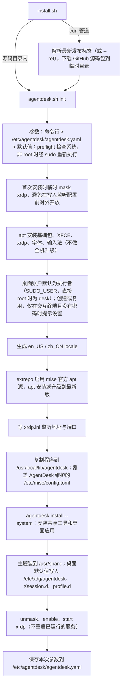

# AgentDesk 架构设计

> 契约：只写现状，必须与代码一致；改代码时同步修改。未完成事项见 [ROADMAP](ROADMAP.md)。

## 概述

AgentDesk 用一个 Bash CLI 把 Ubuntu/Debian 云主机初始化为远程桌面。`agentdesk.sh` 负责系统、账户、XFCE/xrdp 桌面和程序安装；所有软件交给原生 mise 配置管理；创建云主机由 `agentdesk-create` skill 调用云厂商原生 CLI 完成。

配置分三层：**AgentDesk 维护**的通用软件和桌面默认值随 git 版本发布，安装和 `agentdesk update` 时覆盖；**本机管理员**的增补写在 `/etc/mise/config.local.toml`；**每个用户**的软件写在 `~/.config/mise/config.toml`。三层由 mise 原生合并、补齐差异，AgentDesk 不做自己的合并逻辑。命令语义参照 Homebrew：`update` 更新 AgentDesk 自己，`upgrade` 升级软件。不引入自定义配置格式、插件框架、软件别名表或状态数据库。

## 1. 组成

| 文件 | 作用 |
|---|---|
| `install.sh` | 安装入口。`curl \| bash` 时下载最新发布标签（或 `--ref` 指定的分支/标签）的 GitHub 源码包；在源码目录内运行时直接使用本地文件（`--remote` 强制下载，供 `agentdesk update` 使用）。最后都执行 `agentdesk.sh init` |
| `agentdesk.sh` | 全部逻辑：`init`、`verify`、`desktop-reset`、`update`（自我更新），以及分派给原生 mise 的 `install`、`upgrade`、`run` |
| `resources/xdg/` | 桌面系统默认值，安装到 `/etc/xdg/agentdesk/`：XFCE 面板、背景、终端，Fcitx5 自启动与拼音配置 |
| `resources/profile.d/agentdesk.sh` | 登录环境，安装到 `/etc/profile.d/`：mise 工具路径、交互式 bash 的 `mise activate` 与 direnv hook |
| `resources/Xsession.d/` | 图形会话环境，安装到 `/etc/X11/Xsession.d/`：`21agentdesk`（XDG 目录、语言、独立 D-Bus），`90agentdesk-input`（输入法变量） |
| `mise.toml` | AgentDesk 维护的全机软件清单，init/update 时覆盖为 `/etc/mise/config.toml` |
| `mise.example.toml` | 本地清单示例（个人清单或 `config.local.toml`），不安装到主机 |
| `skills/agentdesk-create/` | 创建、部署、验收云主机的 skill |
| `test.sh`、`tests/` | 离线测试与 Docker E2E，见 [TESTING_GUIDE](TESTING_GUIDE.md) |

安装到主机的"程序"固定为 `agentdesk.sh`、`install.sh`、`mise.toml` 三个文件加 `resources/` 目录（见 `program_files`），不另设文件清单。

## 2. 安装流程



重复执行 `init`（不带参数时沿用 `agentdesk.yaml`）会按当前版本重写 AgentDesk 维护的文件，保留 `config.local.toml` 与锁、个人清单、密码和用户自己的桌面设置；已装软件只补缺，不升级。

## 3. 主机文件布局

```text
/usr/local/bin/agentdesk -> /usr/local/lib/agentdesk/agentdesk.sh
/usr/local/lib/agentdesk/        # root 所有，每台主机一份
  agentdesk.sh  install.sh  mise.toml  resources/

/etc/xdg/agentdesk/              # 桌面系统默认值（XFCE、Fcitx5、自启动）
/etc/X11/Xsession.d/21agentdesk  # 图形会话：XDG_CONFIG_DIRS、语言、独立 D-Bus
/etc/X11/Xsession.d/90agentdesk-input
/etc/profile.d/agentdesk.sh      # 登录环境：工具路径、mise activate、direnv hook
/usr/share/themes/WhiteSur-Dark/ # 主题（--theme whitesur）
/usr/share/icons/WhiteSur-dark/

/etc/agentdesk/agentdesk.yaml    # init 保存的参数（用户、主题、语言、RDP），之后的命令以它为默认值

/etc/mise/config.toml            # AgentDesk 维护，随版本覆盖，不要手改
/etc/mise/config.local.toml      # 本机管理员的增补与覆盖（agentdesk install --system NAME）
/etc/mise/mise.lock、mise.local.lock  # 两份清单各自的锁，在本机生成
/usr/local/share/mise/installs/  # 共享工具

~/.config/mise/config.toml       # 个人清单（mise 原生路径）
~/.config/mise/mise.lock
~/.local/share/mise/installs/    # 个人额外工具
```

AgentDesk 不在任何用户的家目录保存自己的文件。Chrome profile、VS Code 设置和 XFCE 配置都留在各自的原生目录。所有改动都直接写入，不做备份。

## 4. 配置分层与软件管理

| 层 | 文件 | 谁维护 | `agentdesk update` 时 |
|---|---|---|---|
| 通用 | `/etc/mise/config.toml` | AgentDesk（git 里的 `mise.toml`，随版本发布） | 直接覆盖，手改的内容会丢失 |
| 本机 | `/etc/mise/config.local.toml` | 本机管理员 | 不动 |
| 个人 | `~/.config/mise/config.toml` | 每个用户（与原生 `mise use -g` 同一文件） | 不动 |

mise 原生加载系统目录的 `conf.d/*.toml` → `config.toml` → `config.local.toml`，后者覆盖前者（已用真实 mise 集成测试验证），再叠加个人目录。所以管理员在 local 文件里写 `node = "22"` 就能覆盖通用清单的版本。两份系统清单的锁分别是 `mise.lock` 和 `mise.local.lock`。个人这一层不再需要 local 文件：`~/.config/mise/config.toml` 本身就完全属于用户。`mise.local.toml` 是项目目录用的文件名，与这里无关。

| 命令 | 作用域 | 行为 |
|---|---|---|
| `agentdesk install NAME...` | 个人 | `mise use --global` 记录并安装；`apt:` 前缀写入 `[bootstrap.packages]` |
| `agentdesk install` | 个人 | 按个人清单和锁补齐 |
| `agentdesk upgrade` | 个人 | `lock --bump` 在声明的版本范围内刷新锁，再 `install --locked`，apt 包执行 upgrade |
| `agentdesk install/upgrade --system` | 系统 | 同上；带名称时写入 `/etc/mise/config.local.toml`，补齐与升级覆盖两份系统清单；需要管理员权限 |
| `agentdesk run TASK [ARGS]` | 个人 | 执行个人清单中的 mise 任务，默认在 HOME 下运行 |

- **作用域隔离**用 mise 原生的 `MISE_IGNORED_CONFIG_PATHS`：个人批量操作忽略 `/etc/mise`，不会替普通用户锁定、安装或升级共享工具和应用；`--system` 操作忽略 `/root/.config/mise`，root 的个人工具不会并入共享清单。运行任务和登录会话仍继承系统默认。
- **`--system` 在干净环境中运行**：`env -i`，`HOME=/root`，只透传代理变量，不读取调用者的项目或 `MISE_*` 设置；成功后把两份清单和两份锁设为 0644。不设置 `MISE_SYSTEM_CONFIG_FILE`：它会让 mise 只读单个文件，`config.local.toml` 将被忽略。root 执行个人命令会被拒绝。
- **软件版本**：仓库不分发锁文件。首次安装按版本策略解析上游版本，在目标主机按本机平台（linux-x64 或 linux-arm64）生成锁。版本经 mise 的版本服务（`use_versions_host = true`）解析，下载地址按 aqua 注册表拼出，不调用 GitHub API，所以没有 token 的新主机不会撞上每 IP 每小时 60 次的匿名限额；之后的 install 沿用锁，upgrade 才刷新。Node 26、Python 3.14 取各自系列的最新版，其余默认 `latest`。upgrade 不删除旧版本。
- **桌面应用**只预装 Chrome 和 VS Code，厂商源直接用 `[bootstrap.apt.sources]` 声明。AI 工具只装命令行版本（Claude Code、Codex、pi），不预装 Claude Desktop、ChatGPT 等桌面客户端。
- 软件名和后端的解析完全交给 mise；只有确实需要额外部署步骤时，才在个人清单里写 `[tasks]`。

## 5. 权限与安全

- **支持范围**：Ubuntu 22.04/24.04/26.04、Debian 12/13，amd64 与 arm64；推荐 Ubuntu 26.04 或 Debian 13。XFCE、xrdp 使用系统官方源的版本，不另行升级。其他 Debian 系（新版本或衍生版）警告后继续；更早的版本、非 Debian 系和其他架构直接拒绝。架构差异交给 apt 和 mise 按本机架构选包，AgentDesk 只在锁文件里记录本机平台；厂商源不限定架构。

- 支持以 root 或 sudo 用户运行。参数先标准化，再经 `sudo /usr/bin/env` 重新执行；代理只透传已设置的 `http_proxy`、`https_proxy`、`all_proxy`、`no_proxy`。
- `--proxy URL` 由每个命令的解析器接受，只在本次运行中导出上述变量，再沿同一条透传路径传给 sudo、`runuser`、mise、apt 和 git；不保存、不写系统配置，因为代理地址可能含账号密码，而设置文件所有人可读。只接受 `http(s)://`（apt 不支持 SOCKS）。
- 下载只有 GitHub 一个来源，网络不通时用 `--proxy`。代理一次覆盖 AgentDesk、mise 的 apt 源、工具的 GitHub Release、主题、厂商 apt 源和 Node、Go；镜像（如 jsDelivr）只能覆盖 AgentDesk 自己的文件，因此不提供。
- `/etc/agentdesk/agentdesk.yaml` 由 root 写入，权限 0644，不含任何凭据；读取时按行解析，不会被当作脚本执行。
- 桌面账户默认是执行安装的人：sudo 运行取 `SUDO_USER`，普通用户运行取自己，直接以 root 运行时新建 `desk`；`--user` 可以覆盖。云镜像默认用户常配置免密 sudo，因此直连 RDP 必须限制来源 IP。
- 系统操作以 root 身份执行，桌面和个人文件一律通过 `runuser` 降权、在干净环境中创建。新账户加入 sudo 组（需要密码，不写 NOPASSWD），已有账户的权限不变。
- 拒绝符号链接形式或非 root 所有、组/其他用户可写的安装目录和系统配置；`/usr/local/bin/agentdesk` 已存在且不是受管软链时拒绝覆盖。
- 不自动生成密码，不修改 SSH 认证、防火墙或云安全组；不自动重启正在运行的 xrdp。
- mise 由官方 apt 源安装（`/usr/bin/mise`），apt 按仓库签名校验；每次 init 升到最新版，`agentdesk upgrade --system` 也会一起升级。不设最低版本要求。

## 6. 桌面

- **桌面配置全部是系统级默认值，不写任何用户的家目录。** init 以 root 写入 `/etc/xdg/agentdesk/`，`/etc/X11/Xsession.d/21agentdesk` 把它放到 `XDG_CONFIG_DIRS` 最前面（与 Xubuntu 的做法相同），不覆盖软件包自带的 `/etc/xdg` 文件。XFCE、Fcitx5 和自启动都遵循 XDG 规范：用户 `~/.config` 中的设置优先，没有时才用系统默认值。因此所有用户（包括之后新增的用户）都使用同一份默认配置，个人修改自然保留。
- **配置内容全部在 `resources/`，脚本里只有逻辑。** 随参数变化的值在文件里写成占位符（`@THEME_NAME@`、`@ICON_THEME@`、`@LOCALE@`），init 复制时替换；取值都是校验过的固定选项。
- 覆盖的 XFCE 频道：面板、外观（xsettings）、窗口管理器、背景、终端。面板启动器直接引用软件包提供的 desktop 文件 ID。背景是 XFCE 原生的深蓝渐变，为 xorgxrdp 的显示器 rdp0–rdp3 预置，不依赖发行版壁纸，也不在登录时运行脚本。
- `21agentdesk` 排在 `20dbus_xdg-runtime` 之后、`75dbus_dbus-launch` 之前：取消共享的用户总线，由 `dbus-launch` 为每个 RDP 会话启动独立的 D-Bus。它同时设置桌面语言（`--locale`）。`90agentdesk-input` 排在 im-config 之后，设置 Fcitx5 的环境变量；守护进程由 XFCE 自启动拉起。
- `/etc/profile.d/agentdesk.sh` 对非 root 用户生效：把个人和共享的 mise shims 加入 PATH，以离线方式加入已安装工具的路径，并在交互式 bash 中依次执行 `mise activate bash` 和 `direnv hook bash`。XFCE 终端默认以登录 shell 启动，所以终端里也会加载它。
- WhiteSur 主题按固定提交以 root 安装到 `/usr/share/themes`、`/usr/share/icons`，所有用户共用；`--theme none` 使用 Greybird/Adwaita。要切换主题，用新参数重新执行 init。默认关闭窗口合成效果。
- `desktop-reset` 是破坏性操作，按 gox shell 规范必须显式加 `--force`。它要求该用户先退出全部会话，然后直接删除上述频道文件和 `panel/` 目录，回到系统默认值，不做备份；其他个人设置保留。XFCE 配置中有符号链接（由 dotfiles 管理）时拒绝执行，避免改到 dotfiles 本身。
- 个人 mise 清单不预先生成。个人批量操作通过环境变量 `MISE_LOCKFILE=1` 启用锁文件，第一次 `agentdesk install NAME` 时由 mise 创建清单。

## 7. 远程连接

- `direct`（默认）监听 `0.0.0.0:PORT`，需要用户自己在安全组或防火墙中限制来源 IP；`tunnel` 只监听 `127.0.0.1`，通过 SSH 端口转发访问。
- `verify` 从 `/etc/xrdp/xrdp.ini` 读取实际的监听地址，`[PASS]/[FAIL]` 输出到 stdout。它只说明服务状态和监听正常，不代表外部可连、也不代表 GUI 验收通过。

## 8. 云环境

`agentdesk-create` skill 根据参数选择 AWS 或阿里云，调用原生 CLI 创建实例和专用安全组，再用远程安装器部署、执行验收并汇总结果。skill 中不写主机地址、账号或资源 ID；实际参数和记录保存在被忽略的 `local/` 下。已有的 VPS 不需要安装任何云 CLI。

## 9. 版本、设置与更新

- **版本号**只有一处：`agentdesk.sh` 的 `VERSION`，`agentdesk --version` 输出。发版时把它改成正式版本号（如 `0.2.0`），提交后打 `v0.2.0` 标签并发布 GitHub Release；开发期间为 `X.Y.Z-dev`。
- **命令语义参照 Homebrew**：

| Homebrew | AgentDesk | 作用 |
|---|---|---|
| `brew update` | `agentdesk update [--ref REF]` | 更新 AgentDesk 自己：默认跟随最新发布标签。版本相同时提示已是最新，显式 `--ref` 时总是重装；否则交给已安装的 `install.sh --remote` 下载，再按 `agentdesk.yaml` 重跑新版本的 init，替换程序和 AgentDesk 维护的配置，只补装新增的软件，不升级已装软件。下载逻辑只在 install.sh 维护一份 |
| `brew upgrade` | `agentdesk upgrade [--system]` | 在声明的版本范围内升级软件 |
| `brew install` | `agentdesk install [--system] [NAME...]` | 记录并安装软件，或补齐清单 |

  与 Homebrew 不同，`upgrade` 不会先自动执行 `update`：update 需要 root 和网络、会改动整台机器，不应被普通用户的 upgrade 顺带触发。
- **设置文件** `/etc/agentdesk/agentdesk.yaml` 由 init 写入，记录用户、主题、语言和 RDP 模式与端口。参数优先级为：命令行 > 设置文件 > 内置默认值，不使用额外的环境变量。`update` 在没有设置文件时拒绝执行，避免用默认值把 `tunnel` 改回直连。
- **为什么用 YAML**：团队的 Go 配置规范是 gox/config（viper）读取 `<app>.yaml`，将来改用 Go 可以直接读取，不用迁移格式。Bash 只需要读两层 `key: value`，由 `settings_read` 用 awk 严格解析，不依赖 yq。

## 10. 不做的事

- 不支持 RHEL、Fedora、openSUSE、Arch 等非 apt 系统：包管理、xrdp 打包、Xsession.d 和 SELinux 都不同，需要另一套实现。

- 不做自定义配置格式、profile 继承、recipes、软件别名表或每个应用一个安装脚本。
- 不做全局回滚框架或通用状态数据库，不对用户任务承诺幂等。
- 不做全机升级、操作系统升级或旧版本路径迁移；不做后台自动更新。
- 不管理防火墙、云资源以外的网络规则，不管理密码。
