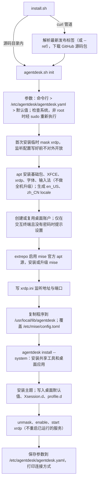

# AgentDesk 架构设计

> 契约：只写现状，必须与代码一致；改代码时同步修改。未完成事项见 [ROADMAP](ROADMAP.md)。

## 概述

AgentDesk 是一个 Bash CLI，把 Ubuntu/Debian 云主机初始化为 XFCE/xrdp 远程桌面。`agentdesk.sh` 负责系统、账户、桌面和程序安装；软件全部交给原生 mise；云主机由 `agentdesk-create` skill 调用云厂商原生 CLI 创建。不引入自定义配置格式、插件框架、软件别名表或状态数据库。

支持 Ubuntu 22.04/24.04/26.04、Debian 12/13，amd64 与 arm64，推荐 Ubuntu 26.04 或 Debian 13。其他 Debian 系（新版本或衍生版）警告后继续；更早的版本、非 Debian 系和其他架构直接拒绝。架构差异交给 apt 和 mise 按本机架构选包。

## 1. 组成

| 文件 | 作用 |
|---|---|
| `install.sh` | 安装入口。管道运行时下载最新发布标签（或 `--ref`）的 GitHub 源码包；在源码目录内直接用本地文件（`--remote` 强制下载，供 `agentdesk update` 使用）。最后执行 `agentdesk.sh init` |
| `agentdesk.sh` | 全部逻辑：`init`、`verify`、`info`、`rdp`、`desktop-reset`、`update`，以及分派给原生 mise 的 `install`、`upgrade`、`run` |
| `resources/` | 安装到主机的配置：`xdg/`（XFCE、Fcitx5 默认值）、`Xsession.d/`（图形会话环境）、`profile.d/`（登录环境） |
| `mise.toml` | AgentDesk 维护的全机软件清单，init 时覆盖为 `/etc/mise/config.toml` |
| `mise.example.toml` | 本地清单示例，不安装到主机 |
| `skills/agentdesk-create/` | 用云厂商原生 CLI 创建、部署、验收云主机；skill 里不写主机地址、账号或资源 ID，运行记录放在被忽略的 `local/` |
| `test.sh`、`tests/`、`.github/workflows/` | 离线测试、Docker E2E 和 CI，见 [TESTING_GUIDE](TESTING_GUIDE.md) |

安装到主机的程序固定为 `agentdesk.sh`、`install.sh`、`mise.toml` 加 `resources/`（见 `program_files`），不另设文件清单。

## 2. 安装流程



重复执行 `init`（不带参数时沿用 `agentdesk.yaml`）按当前版本重写 AgentDesk 维护的文件，保留 `config.local.toml` 与锁、个人清单、密码和用户自己的桌面设置；已装软件只补缺，不升级。

## 3. 主机文件布局

```text
/usr/local/bin/agentdesk -> /usr/local/lib/agentdesk/agentdesk.sh
/usr/local/lib/agentdesk/            # 程序，root 所有
/etc/agentdesk/agentdesk.yaml        # init 保存的参数
/etc/xdg/agentdesk/                  # 桌面系统默认值（XFCE、Fcitx5、自启动）
/etc/X11/Xsession.d/21agentdesk      # 图形会话：XDG_CONFIG_DIRS、语言、独立 D-Bus
/etc/X11/Xsession.d/90agentdesk-input
/etc/profile.d/agentdesk.sh          # 登录环境：工具路径、mise activate、direnv hook
/usr/share/themes/WhiteSur-Dark/     # 主题（--theme whitesur）
/etc/mise/config.toml                # AgentDesk 维护，随版本覆盖
/etc/mise/config.local.toml          # 本机管理员的增补与覆盖
/etc/mise/mise.lock、mise.local.lock # 两份系统清单各自的锁，在本机生成
/usr/local/share/mise/installs/      # 共享工具
~/.config/mise/config.toml           # 个人清单（与 mise use -g 同一文件）
~/.local/share/mise/installs/        # 个人工具
```

AgentDesk 不在用户家目录保存自己的文件；所有改动直接写入，不做备份。

## 4. 软件

| 层 | 文件 | 谁维护 | `agentdesk update` 时 |
|---|---|---|---|
| 通用 | `/etc/mise/config.toml` | AgentDesk（仓库里的 `mise.toml`） | 直接覆盖 |
| 本机 | `/etc/mise/config.local.toml` | 本机管理员 | 不动 |
| 个人 | `~/.config/mise/config.toml` | 每个用户 | 不动 |

mise 原生按 `conf.d/*.toml` → `config.toml` → `config.local.toml` 加载系统目录，后者覆盖前者，再叠加个人目录；AgentDesk 不做自己的合并逻辑。

| 命令 | 作用域 | 行为 |
|---|---|---|
| `agentdesk install NAME...` | 个人 | `mise use --global` 记录并安装；`apt:` 前缀写入 `[bootstrap.packages]` |
| `agentdesk install` | 个人 | 按清单和锁补齐 |
| `agentdesk upgrade` | 个人 | `lock --bump` 在版本范围内刷新锁，再 `install --locked`；apt 包执行 upgrade |
| `agentdesk install/upgrade --system` | 系统 | 同上；带名称时写入 `config.local.toml`；需要管理员权限 |
| `agentdesk run TASK [ARGS]` | 个人 | 执行个人清单中的 mise 任务 |

- **作用域隔离**用 mise 原生的 `MISE_IGNORED_CONFIG_PATHS`。个人操作只在锁定和 apt 包命令上忽略 `/etc/mise`，不改系统锁，也不替用户升级共享应用；`use`、`install`、`reshim` 照常加载系统清单，与直接运行 mise 一致。原因：mise 在共享安装目录里为每个工具维护 `global` 链接，指向当前用户的全局与系统配置所选的版本，忽略系统清单会让它去改这些链接，而那需要 root。个人锁通过 `MISE_LOCKFILE=1` 开启，不依赖系统清单里的设置。
- **`--system` 在干净环境中运行**：`env -i`、`HOME=/root`，只透传代理变量，忽略 `/root/.config/mise`；成功后两份清单和锁设为 0644。不设 `MISE_SYSTEM_CONFIG_FILE`，否则 mise 只读单个文件，`config.local.toml` 会被忽略。root 执行个人命令会被拒绝。
- **版本与锁**：仓库不分发锁文件，在目标主机按本机平台（linux-x64 或 linux-arm64）生成。版本经 mise 的版本服务（`use_versions_host = true`）解析，下载地址按 aqua 注册表拼出，不调用 GitHub API，没有 token 的新主机不会撞上每 IP 每小时 60 次的匿名限额。之后 install 沿用锁，upgrade 才刷新，不删除旧版本。
- **mise 本身**由官方 apt 源安装（`/usr/bin/mise`，apt 按签名校验），每次 init 升到最新版，`upgrade --system` 也会升级；不设最低版本。
- **预装**以 `mise.toml` 为准：命令行工具交给 mise，Chrome、VS Code、tmux 经 apt。AI 工具只装命令行版本，不装桌面客户端。

## 5. 桌面

- **全部是系统级默认值，不写用户家目录。** 默认值写在 `/etc/xdg/agentdesk/`，由 `21agentdesk` 放到 `XDG_CONFIG_DIRS` 最前（与 Xubuntu 相同），不覆盖软件包自带的 `/etc/xdg`。用户 `~/.config` 中的设置优先，所以所有用户（含之后新增的）共用一份默认值，个人修改自然保留。
- **配置内容全部在 `resources/`，脚本里只有逻辑。** 随参数变化的值写成占位符（`@THEME_NAME@`、`@ICON_THEME@`、`@LOCALE@`），init 复制时替换；取值都是校验过的固定选项。
- 覆盖的 XFCE 频道：面板、外观、窗口管理器、背景、终端。面板启动器引用软件包的 desktop ID；背景是 XFCE 原生渐变，为 xorgxrdp 的显示器 rdp0–rdp3 预置。
- `21agentdesk` 排在 `20dbus_xdg-runtime` 之后、`75dbus_dbus-launch` 之前，取消共享用户总线，让每个 RDP 会话有独立 D-Bus，并设置桌面语言。`90agentdesk-input` 排在 im-config 之后，设置 Fcitx5 变量。
- `profile.d/agentdesk.sh` 对非 root 用户生效：加入 mise shims 和已安装工具路径（离线解析），交互式 bash 再依次执行 `mise activate` 和 `direnv hook`。XFCE 终端以登录 shell 启动，所以会加载它；`ssh 主机 命令` 这类非登录 shell 不加载。
- WhiteSur 主题按固定提交装到 `/usr/share`；`--theme none` 用 Greybird/Adwaita。
- `desktop-reset` 必须加 `--force`：要求该用户先退出全部会话，删除上述频道文件和 `panel/` 目录，不做备份；配置中有符号链接（dotfiles）时拒绝。
- 不修改系统时区（云镜像默认 UTC）。

## 6. 远程连接

- `direct`（默认）监听 `0.0.0.0:PORT`，由用户在安全组或防火墙中限制来源 IP；`tunnel` 只监听 `127.0.0.1`，经 SSH 端口转发访问。
- `verify` 从 `xrdp.ini` 读取实际监听，`[PASS]/[FAIL]` 输出到 stdout；它不代表外部可连，也不代表 GUI 验收通过。
- `info` 输出连接方式（init 结束时也会打印），`rdp` 输出 `.rdp` 文件，都写 stdout、不需要 root、不输出凭据。公网地址只读云平台实例元数据：DMI 厂商为 Amazon EC2 时走 IMDSv2，为 Alibaba Cloud 时读 `eipv4`/`public-ipv4`；请求绕过代理，其他厂商不发请求，地址显示为 `SERVER`。macOS 上用 `.rdp` 文件打开 Windows App，因为它不保证支持 `rdp://` 链接。

## 7. 权限与安全

- 支持 root 或 sudo 用户运行：参数先标准化，再经 `sudo /usr/bin/env` 重新执行；系统操作以 root 执行，桌面和个人文件通过 `runuser` 降权、在干净环境中创建。
- 代理只透传已设置的 `http_proxy`、`https_proxy`、`all_proxy`、`no_proxy`。`--proxy URL` 只在本次运行导出这些变量，不保存（地址可能含密码，而设置文件所有人可读）；只接受 `http(s)://`（apt 不支持 SOCKS）。
- 不提供下载镜像：网络不通时用 `--proxy`，它一次覆盖全部下载；镜像只能覆盖 AgentDesk 自己的文件。
- `agentdesk.yaml` 由 root 写入，0644，不含凭据，按行解析，不当作脚本执行。
- 默认桌面账户是执行安装的人（`SUDO_USER`；直接以 root 运行时新建 `desk`）。云镜像默认用户常有免密 sudo，所以直连 RDP 必须限制来源 IP。新账户加入 sudo 组（需要密码）。
- 拒绝符号链接形式、非 root 所有或组/其他可写的安装目录和系统配置；`/usr/local/bin/agentdesk` 不是受管软链时拒绝覆盖。
- 不自动生成密码，不修改 SSH 认证、防火墙或云安全组，不自动重启运行中的 xrdp。

## 8. 版本与更新

- **版本号**只在 `agentdesk.sh` 的 `VERSION`。发版提交写正式版本（如 `0.3.0`）、打 `v0.3.0` 标签并发布 GitHub Release；发版后的第一个改动把它改为下一个开发版本（如 `0.3.1-dev`）。
- **命令语义参照 Homebrew**；与 Homebrew 不同，`upgrade` 不会先执行 `update`，因为 update 需要 root、会改动整台机器。

| Homebrew | AgentDesk | 作用 |
|---|---|---|
| `brew update` | `agentdesk update [--ref REF]` | 更新 AgentDesk：默认跟随最新发布标签，版本相同时提示已是最新（显式 `--ref` 总是重装）；由已安装的 `install.sh --remote` 下载，再按 `agentdesk.yaml` 重跑 init，只补装新增软件 |
| `brew upgrade` | `agentdesk upgrade [--system]` | 在声明的版本范围内升级软件 |
| `brew install` | `agentdesk install [--system] [NAME...]` | 记录并安装软件，或补齐清单 |

- **设置文件** `agentdesk.yaml` 记录用户、主题、语言和 RDP 模式与端口；优先级为命令行 > 设置文件 > 默认值，不使用额外的环境变量。没有设置文件时 `update` 拒绝执行，避免用默认值把 `tunnel` 改回直连。选 YAML 是因为团队 Go 配置规范（gox/config）读取 `<app>.yaml`；Bash 侧由 `settings_read` 用 awk 只解析两层 `key: value`。

## 9. 不做的事

- 不支持 RHEL、Fedora、openSUSE、Arch 等非 apt 系统。
- 不做自定义配置格式、profile 继承、软件别名表或每个应用一个安装脚本。
- 不做回滚框架、状态数据库，不对用户任务承诺幂等。
- 不做全机升级、操作系统升级或后台自动更新。
- 不管理防火墙、云安全组和密码。
