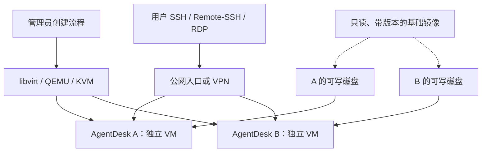

# KVM 托管 AgentDesk：镜像、SSH、节点与容量实施参考

> 设计稿：未实现，不作为现状引用。

## 概述

日期：2026-10-20。状态：未来实施参考，尚未部署或压测。本文整理“快速申请一套独立 AgentDesk 并返回 SSH 入口”的候选实现，不代表当前项目已经提供托管平台。

面向未来实施者，建议路线为 **QEMU/KVM + libvirt + 预装镜像 + 每实例持久磁盘 + SSH 入口**。底层原理及 Firecracker 的版本化接口详见 [KVM、microVM 与 Firecracker 技术方案](KVM_MICROVM_FIRECRACKER.md)；本文侧重单机落地、扩展到多节点及资源核算。

## 1. 先回答三个关键问题

1. **KVM 和 Firecracker 不是两个平级替代品。** KVM 提供 Linux 内核中的硬件虚拟化接口；Firecracker 是使用 KVM 的用户态虚拟机管理器。QEMU 也可以使用 KVM。
2. **KVM 本身没有开箱即用的集群控制面。** 多节点调度、共享入口、迁移和故障恢复由上层管理工具提供；一个普通 VM 的 CPU 和内存仍来自某一个宿主节点。
3. **4 vCPU / 16 GiB 的 AWS 实例，不宜承诺交付两套完整的 2 vCPU / 8 GiB AgentDesk。** 两套客户机已经占满全部标称内存，宿主系统和虚拟机运行开销没有余量。若支持并启用了嵌套虚拟化，先按一套规划；不支持时不能运行这条 KVM 路线。

第三项是资源预算判断，不是压测结论。Docker 也不能绕过宿主机的内存需求；“允许创建两个 8 GiB 限额的容器”不等于“两个容器随时都有 8 GiB 可用”。

## 2. 技术分层：KVM、QEMU、Firecracker、libvirt

```text
用户 / 创建环境命令
        │
        ├─ 通用 VM 路线：libvirt → QEMU ──────┐
        │                                  │
        └─ microVM 路线：编排程序 → Firecracker ┤
                                           ↓
                                    Linux KVM
                                           ↓
                                    CPU 硬件虚拟化
```

| 组件 | 负责什么 | 不自动提供什么 |
| --- | --- | --- |
| KVM | 通过内核接口运行虚拟 CPU 等 | 镜像仓库、用户管理、跨节点调度 |
| QEMU | 客户机设备、内存、磁盘与机器运行；使用 KVM 加速 | 完整的多租户工作空间产品 |
| Firecracker | 精简的 microVM 运行与 API；同样使用 KVM | 全套网络、磁盘克隆和集群管理 |
| libvirt | 用现有 API/命令管理 QEMU/KVM 机器及相关资源 | 自动成为完整的集群调度平台 |
| AgentDesk | 在客户机内安装桌面、工具和用户环境 | 宿主节点管理 |

这里的“VM 有独立内核”是每台运行自己的 Linux 软件内核，不是每台必须独占一个物理 CPU 核心。vCPU 是客户机看到的执行单元，仍需由宿主机调度。

依据：[KVM API](https://docs.kernel.org/virt/kvm/api.html)、[QEMU 系统虚拟化](https://www.qemu.org/docs/master/system/introduction.html)、[Firecracker](https://firecracker-microvm.github.io/)、[libvirt QEMU 驱动](https://libvirt.org/drvqemu.html)。

本文首先选通用 QEMU/KVM，是因为当前 AgentDesk 面向完整 Linux 桌面，依赖 systemd、XFCE、xrdp、浏览器和编辑器。Firecracker 的模板恢复与精简运行方式可后续单独评估；不能假定现有 libvirt 管理流程直接替换为 Firecracker。

## 3. 单宿主机的候选结构



宿主机只承载虚拟化、存储、网络及管理服务；桌面和用户开发任务运行在客户机里。

单机阶段使用原生命令和少量编排即可。需要记录实例 ID、所属用户、镜像版本、节点、磁盘、MAC、内网 IP、SSH 入口及生命周期；先使用明确的实例记录，不提前设计通用云 SDK 或控制面。

实例 ID 应稳定且唯一。资源分配需要锁或等价的串行操作，避免同时创建时分到相同 IP、端口或磁盘路径；创建失败后按实例记录回收，不按模糊名称批量删除。

## 4. 镜像与持久磁盘

### 4.1 先制作一个通过验收的模板

候选构建步骤：

1. 选定 Ubuntu/Debian 官方虚拟机镜像，固定来源、架构、校验和及版本。
2. 启动构建 VM，等待 systemd 与网络正常。
3. 在运行中的 VM 内执行同一 `agentdesk.sh` 与 mise 安装任务。
4. 验证 SSH、RDP、中文输入、浏览器、编辑器和工具路径。
5. 在模板中不登录个人账户；清理构建凭据与临时数据，按所用镜像初始化机制处理 machine-id、SSH 主机密钥、cloud-init 状态。
6. 正常关机后发布只读模板，记录 AgentDesk 版本、mise lock、软件和镜像校验信息。
7. 从模板克隆两台 VM，验证身份、网络、磁盘和用户配置相互独立。

清理身份后不应再次把构建 VM 当普通桌面启动使用并直接发布。新实例应有独立 UUID、MAC、主机名和初始化实例 ID，在首次启动阶段生成其机器身份并注入获授权用户的公钥。

### 4.2 每套环境有自己的可写系统盘

QEMU 的候选方式是只读 qcow2 基础镜像加每实例差异盘。基础模板被共享，写入进入对应实例差异盘；这避免每次完整复制公共系统文件。[QEMU 磁盘镜像](https://www.qemu.org/docs/master/system/images.html)

```text
agentdesk-base-v1.qcow2（发布后不可变）
    ├─ instance-a/system.qcow2
    └─ instance-b/system.qcow2
```

实现时应满足：

- 基础镜像仍有差异盘引用时，不能删除、覆盖或就地升级它。
- 实例的系统盘持续保留，才能保住用户通过 apt 等方式安装的软件；只保留 `/home` 不等于保留完整工作环境。
- 可另外挂载项目数据盘，但备份和恢复应覆盖相关系统盘、数据盘及配置。
- 长期运行时避免不断叠加差异链；根据存储后端验证合并或转换流程。
- 镜像更新生成新版本，已有 VM 不会因为基础模板更新就自动升级。

qcow2 是此处 QEMU 路线的选择。Firecracker 需要另行准备内核和受支持的块设备后端，不能直接套用 qcow2 差异盘方案。

模板、磁盘快照和内存快照要分开：磁盘模板通常需要重新启动系统；内存恢复还涉及 CPU/设备兼容、对应磁盘时间点和连接重建。首阶段不承诺恢复正在运行的进程。

## 5. 网络与 SSH 交付

### 5.1 每实例内网 IP，对外共享公网 IP

单机 POC 可采用 libvirt 私网与 NAT，入站另设受控端口转发。libvirt 的 NAT 网络不等于自动为每台客户机发布公网 SSH。[libvirt 网络配置](https://libvirt.org/formatnetwork.html)

以下地址仅用于示意：

| 环境 | 客户机 SSH | 公网 SSH |
| --- | --- | --- |
| A | `10.20.0.11:22` | `203.0.113.10:22001` |
| B | `10.20.0.12:22` | `203.0.113.10:22002` |
| C | `10.20.0.13:22` | `203.0.113.10:22003` |

内部 IP 不同，因此都能监听 22；外部 IP 相同，因此用不同端口区分。出站可以经宿主机 NAT，共享公网地址，不要求每实例购买公网 IPv4。

端口转发需要同时处理入口防火墙、安全组、IP forwarding、转发链和返回路径。规则归属应明确，避免自定义规则与 libvirt 管理的规则互相覆盖；宿主机重启后需恢复并验证。

在 AWS 内部先采用 NAT 可减少把客户机 MAC/IP 直接暴露给 VPC 的需求。不能假设把 VM 网桥接到 EC2 网卡，就自动获得可用的 VPC 地址。

### 5.2 用 SSH 别名隐藏端口细节

创建成功后可以输出受管配置片段：

```sshconfig
Host desk-a
    HostName 203.0.113.10
    Port 22001
    User desk
    IdentityFile ~/.ssh/id_ed25519
```

于是用户输入 `ssh desk-a`。配置可以放入独立文件，再由用户现有配置 `Include`；不要覆盖整个 `~/.ssh/config`。同时通过可信管理路径交付主机指纹或使用主机证书，不通过关闭主机校验来省略身份验证。[OpenSSH 配置](https://man.openbsd.org/ssh_config)

对于当前 AgentDesk，可在客户机选择 RDP tunnel 模式，然后运行：

```bash
ssh -N -L 13389:127.0.0.1:3389 desk-a
```

RDP 客户端连接本机 `127.0.0.1:13389`。SSH 密钥认证与 xrdp 的用户登录是两回事；当前桌面首次密码仍需按现有流程设置，不能因为 SSH 公钥可用就宣称桌面已可登录。

### 5.3 其他入口选项与隔离

| 入口 | 特点 |
| --- | --- |
| 公网 IP + 独立端口 | 适合单机起步；实例端口需分配、持久记录和回收 |
| SSH 跳板机 / ProxyJump | 入口连接后访问 VM 内网地址；需限制用户可转发的目标 |
| VPN | 用户通过授权内网地址访问，不逐台开放公网入口 |
| 独立公网 IP | 每实例可用 22；需要可路由地址资源和配套规则 |

普通 SSH 不像 HTTP Host/SNI 那样直接按请求域名分流。多个域名指向同一个 IP、同一个端口，并不足以识别目标 VM。

boxd 在 2026-03-10 的架构文章中描述了代理公网 IP、每 VM 独立端口和 CLI 管理 SSH 别名的方式，并由代理执行身份认证；这是公开架构说明，不是我们对当前服务端实现的源码审计。[boxd 架构](https://boxd.sh/blog/architecture/how-boxd-works/)

独立内网 IP 不等于隔离。未来多用户实施时应明确限制跨 VM 流量、访问宿主管理服务及 AWS 实例元数据的路径；桌面用户不能调用 libvirt 管理接口。验证允许和拒绝的流量，而非只验证 SSH 能连通。

## 6. 快速创建的流程与验收

以下是未来流程设计，不是已存在的 AgentDesk 子命令：

```text
确认请求与实例 ID
  → 选择有容量的节点
  → 预留资源与记录归属
  → 检查本地模板缓存
  → 创建可写磁盘与实例初始化数据
  → 分配 MAC、内网 IP、外部 SSH 入口
  → 定义并启动 VM
  → 等待 SSH 与初始化完成
  → 检查桌面依赖和连接路径
  → 返回资源、连接信息和验证状态
```

关键设计要求：

- 安装大软件、下载基础镜像放在模板构建或预热阶段；创建实例主要复用模板。
- 请求重复提交先查询相同实例 ID 的实际状态，不能直接创建第二台。
- 返回地址与返回“已就绪”分开；只有外部 SSH 实际成功才标记 SSH ready。
- VM running、SSH ready、RDP 可登录、应用可用分别记录，不能互相替代。
- 失败记录已创建对象和阶段，按归属清理；已有用户磁盘保留策略必须明确。
- 将资源准备、启动、SSH、首次桌面和应用耗时分别测量，报告端到端时间。

磁盘写时复制、缓存和预启动池都可能加速交付，但收益以实测为准。预启动池消耗常驻资源；本地无镜像时的下载耗时也必须计入冷创建结果。

## 7. 多节点与集群：KVM 没有内置调度器

“KVM 集群”通常指多个运行 KVM 的宿主机由上层平台统一管理。可以采用 Proxmox VE 等现有工具；libvirt 也提供远程管理能力，但远程管理多个节点本身不等于自动调度和高可用。

```text
统一创建入口 / 调度
    ├─ node-1：Linux + KVM → VM A、VM B
    └─ node-2：Linux + KVM → VM C、VM D
```

**一个普通 VM 的 2 vCPU / 8 GiB 必须在一个节点上获得。** 不能在 node-1 分配 1 vCPU / 4 GiB，再在 node-2 分配另一半，拼成一台普通 KVM VM。

需要分别解决：

| 能力 | 需要的工作 |
| --- | --- |
| 节点管理 | 登记节点、健康、版本、可用容量与模板 |
| 调度 | 按节点实际可用资源放置 VM，处理并发预留 |
| 网络入口 | 入口映射到正确节点，保证跨节点私网可达或经隧道转发 |
| 镜像分发 | 各节点缓存相同校验的基础镜像 |
| 数据移动 | 共享存储、复制或迁移磁盘；本地差异盘不会自行出现在其他节点 |
| 故障恢复 | 磁盘可用、容量有余量、控制面正常，防止同一磁盘被两台 VM 同时写入 |

Proxmox VE 提供集群管理与迁移能力。其文档建议可靠 HA 仲裁至少有三个节点；两节点集群可按文档评估独立 QDevice，但仲裁见证不提供额外运行 VM 的容量，也不代替数据复制。[Proxmox VE 管理指南](https://pve.proxmox.com/pve-docs/pve-admin-guide.pdf)

节点迁移不意味着把两台服务器合为一颗 CPU。迁移还取决于 CPU 兼容、存储、网络和平台能力；宿主机故障后的 HA 重启一般也不等于保留故障时的全部内存与连接。

建议演进顺序：单节点成功 → 多节点手工放置 → 有需求时采用现成集群管理 → 再设计自动调度和 HA。若采用 Proxmox，沿用其管理接口与资源归属，避免另一套脚本绕过平台修改同一组 VM。

## 8. 容量计算：标称配置不是可交付总量

### 8.1 统一单位与预算

本文用 vCPU 和 GiB 核算云实例；用户口语中的“2 核 8G”在这里解释为 **2 vCPU / 8 GiB**，不代表两颗独占物理核心。

对一个节点，在不超配的简化预算下：

```text
CPU 容量 = floor((节点可用 vCPU 预算 - 宿主 CPU 预留) / 每 VM vCPU)
内存容量 = floor((节点内存 - 宿主及公共服务预留)
                 / (每 VM 客户机内存 + 每 VM 外部运行开销预算))

可交付数量 ≤ min(CPU 容量, 内存容量, 磁盘容量约束)
```

vCPU 数量只用于同一资源口径下的初步预算，不能把硬件线程与物理核心混算。CPU 配额、权重和绑定是否提供所需保障，要另外配置与验证。磁盘 IOPS、网络和桌面交互延迟会进一步限制实际并发。

### 8.2 4 vCPU / 16 GiB 的 AWS 主机可以放几套 2 vCPU / 8 GiB？

| 情况 | 判断 |
| --- | --- |
| 实例不支持或未启用嵌套虚拟化 | 不能启动此 KVM 路线；可选择直接安装 AgentDesk |
| 只按标称资源相除 | 得到 2，但忽略全部宿主开销 |
| 每套确实需要完整 8 GiB，且不超配内存 | 先按 **1 套**规划 |
| 两套只配置 8 GiB 上限，实际都很空闲 | 可能启动，不应承诺两套同时满额可用 |
| 使用 Docker 设两个 8 GiB 限额 | 同样不是两个 8 GiB 的内存预留 |

举例预留 1 vCPU、2 GiB 给宿主与公共服务，再给每 VM 外部运行开销留 0.5 GiB，则：

```text
CPU：floor((4 - 1) / 2) = 1
内存：floor((16 - 2) / (8 + 0.5)) = 1
```

这里的 1 vCPU、2 GiB 和 0.5 GiB 是演示预算，不是 QEMU 或 Firecracker 固定开销。客户机的 8 GiB 已包含客户机内核、系统服务及桌面应用；0.5 GiB 是另给宿主侧开销留的示例余量，不应重复计算整个客户机系统。

CPU 可以允许错峰共享；内存初期不建议超配，不把 swap、balloon 或内存去重当成额外的可承诺物理内存。若实际目标只是交付一套 2/8，直接租相应 EC2 并初始化，通常比用 4/16 再嵌套一套更简单。

### 8.3 两台 4/16 是否等于一台 8/32？

不等于。在上述预留口径下，两台 4/16 各放一套 2/8，总共两套。每台都承担一次宿主开销，无法把分散在不同节点上的空闲内存凑给同一 VM。

如果还要求任一节点故障后接管全部环境，需要按剩余节点容量规划。两台各只能承载一套的节点，满载运行两套时，没有承载另一套的故障接管余量。

## 9. AWS 嵌套虚拟化的实施前核查

AWS 当前官方文档已提供普通虚拟 EC2 的嵌套虚拟化能力，可在受支持型号上运行 KVM；不能继续笼统地认为只有 `.metal` 可以。也不能从“4 vCPU / 16 GiB”推断任意同规格实例都支持。[AWS 嵌套虚拟化](https://docs.aws.amazon.com/AWSEC2/latest/UserGuide/amazon-ec2-nested-virtualization.html)

不同官方页面的支持列表可能更新不同步；例如本次查询的用户指南范围比 CPU API 参数页更广。实施时核对目标 Region 和实例型号的 API 返回，再实际启动最小 VM。[CPU API 参数说明](https://docs.aws.amazon.com/AWSEC2/latest/APIReference/API_CpuOptionsRequest.html)

可在实施阶段执行以下只读查询；本文编写过程中没有调用用户 AWS 账号：

```bash
aws ec2 describe-instance-types \
  --region ap-northeast-1 \
  --instance-types m8i.xlarge \
  --query 'InstanceTypes[].{Type:InstanceType,VCPU:VCpuInfo.DefaultVCpus,MemoryMiB:MemoryInfo.SizeInMiB,Features:ProcessorInfo.SupportedFeatures}' \
  --output json
```

`m8i.xlarge` 仅作候选查询示例，不代表已确认该账号、区域有容量或已获准创建。应确认返回的 `Features` 包含 `nested-virtualization`，并在启动配置中显式启用对应 CPU 选项；已有实例变更按官方要求停机处理。

在宿主机核查 `/dev/kvm`、运行权限及 KVM 加速能力，并实际启动最小客户机。只有设备文件存在或软件已安装都不足以验收；没有 KVM 时的 QEMU TCG 软件模拟不算此方案通过。[AWS 虚拟化入门](https://docs.aws.amazon.com/linux/al2023/ug/virtualization-getting-started.html)

当前项目其他 POC 使用的实例，不因此自动成为嵌套虚拟化宿主。不能把普通 EC2 桌面验收当成 KVM 托管验收。

## 10. 分阶段实施与交付标准

| 阶段 | 工作 | 通过标准 |
| --- | --- | --- |
| A：宿主能力 | 固定 OS、QEMU/libvirt、CPU 架构，验证 KVM | 最小客户机以 KVM 加速运行并可执行命令 |
| B：两套独立桌面 | 在有足够容量的宿主创建两台 VM，执行 AgentDesk | SSH/RDP、中文、应用、独立磁盘和网络策略均通过 |
| C：模板交付 | 构建干净模板，克隆两台，分配入口 | 无重复机器身份；返回别名可用；创建无需重装公共软件 |
| D：生命周期 | 重启 VM、重启宿主、备份恢复、失败重试和删除 | 用户数据保留，映射恢复，无重复实例或资源误删 |
| E：容量测试 | 固定浏览器、编辑器、Agent、测试/编译负载逐步加压 | 记录可接受响应下的并发、峰值内存、CPU、磁盘延迟 |
| F：多节点 | 模板分发、放置、入口更新及恢复演练 | 单 VM 不跨节点拼资源；节点故障处理符合实际存储和余量 |

每阶段记录硬件、CPU 线程口径、软件版本、镜像校验、样本量、成功与失败时间。文档中的容量示例不能替代这些记录。

最终至少输出：实例 ID、节点、镜像版本、资源配置、磁盘保留策略、SSH 入口与主机身份信息、RDP 使用方式、已验证事项和未验证事项。不输出用户私钥、密码或 token。

## 11. 与现有 AgentDesk 的边界

`agentdesk.sh` 继续负责客户机初始化，mise 继续负责软件。未来宿主机编排放在外层，按触发需求采用现成工具，不把虚拟化依赖加入所有 AgentDesk 安装。

本文不新增当前实施计划中的已批准任务，不创建云资源，也不承诺 boxd 的毫秒级启动、在线 fork 或故障无损恢复。将来正式实施时，从阶段 A 开始，以验证结果决定是否进入下一阶段。
