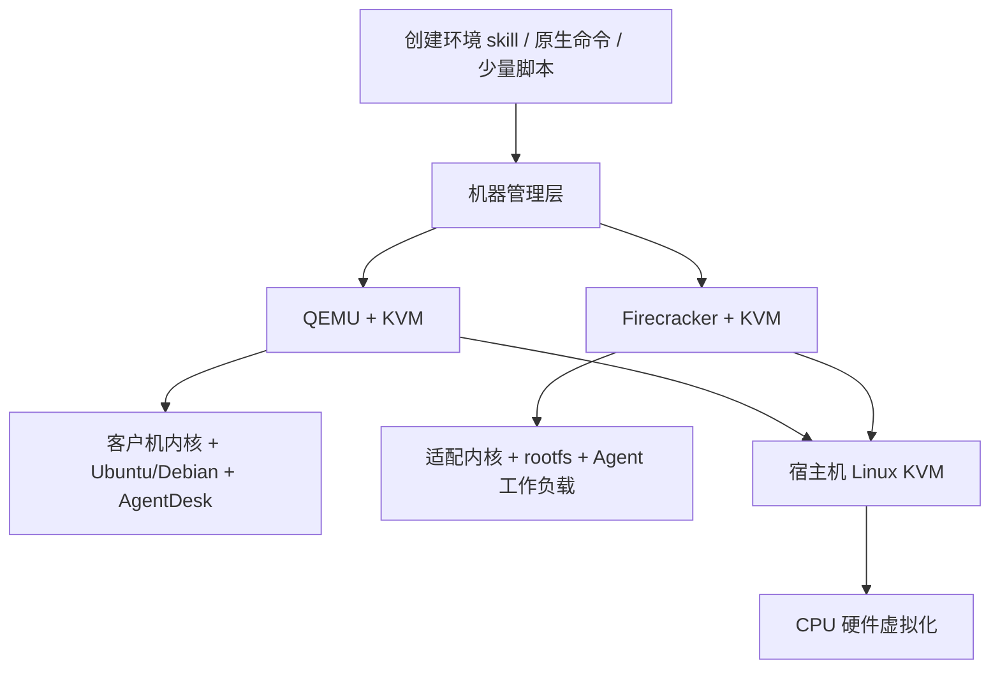
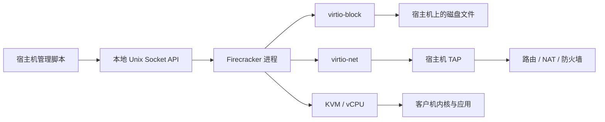

# KVM、microVM 与 Firecracker 技术方案

> 设计稿：未实现，不作为现状引用。

## 概述

日期：2026-10-20。本文是技术研究与候选方案，尚未部署虚拟机或进行性能测试，不改变当前 AgentDesk 的交付范围。

Firecracker 的实现说明以 **v1.17.0** 发布标签下的文档与 API 定义为基线，避免把主分支功能直接当成部署承诺。[对应发行版](https://github.com/firecracker-microvm/firecracker/releases/tag/v1.17.0)。当前待办见 [ROADMAP](ROADMAP.md)。

## 1. 对 AgentDesk 的结论

三条路线解决不同问题：

| 需求 | 建议路线 | AgentDesk 的位置 |
| --- | --- | --- |
| 把一台已有 VPS/EC2/ECS 变成可用桌面 | 直接初始化当前云主机 | 保持 Bash + mise + XFCE/xrdp |
| 在一台大服务器上运行多个独立完整桌面 | 优先评估 QEMU/KVM + libvirt | 每台客户机内复用同一初始化脚本 |
| 批量创建隔离的 Agent 执行环境，重视启动密度和模板恢复 | 评估 Firecracker microVM | 先验证最小 Agent 环境，再验证完整桌面是否值得承载 |

这是根据当前产品需求作出的选型判断。Firecracker 可以作为未来底层运行环境，但接入后需要承担镜像、网络、进程生命周期和快照管理工作，不能只把它看成一条安装命令。

**microVM 不等于“只能运行命令行”，也不等于“安装完整桌面后仍只占几 MB”。** 是否能运行 XFCE/xrdp，取决于客户机内核、用户空间和显示方案；实际内存与 CPU 消耗主要需要通过桌面应用负载测量。

## 2. 概念与分层

### 2.1 KVM、VMM、microVM 分别是什么

| 名称 | 职责 | 不应混淆的地方 |
| --- | --- | --- |
| KVM | Linux 内核中的虚拟化能力，通过 `/dev/kvm` 等接口创建 VM、虚拟 CPU 并执行客户机代码 | KVM 接口本身不负责交付一套桌面或云平台 |
| VMM | 用户态虚拟机管理器，组织客户机内存、虚拟设备和生命周期，并使用 KVM | Firecracker、采用 KVM 加速的 QEMU 属于这一层 |
| microVM | 精简虚拟硬件和启动流程的虚拟机形态 | 不是单一产品，也不是一个独立于 KVM 的统一标准 |
| libvirt | 管理虚拟机、连接和配置的现有工具/API 层 | 本文采用它管理 QEMU/KVM，不假定它原生管理 Firecracker |
| boxd | 工作空间平台，将虚拟机与访问、复制、身份、计费等能力组合交付 | 其使用 KVM microVM，不足以证明它使用 Firecracker |

依据：[KVM API](https://docs.kernel.org/virt/kvm/api.html)、[Firecracker 概览](https://github.com/firecracker-microvm/firecracker/blob/v1.17.0/README.md)、[QEMU 架构](https://www.qemu.org/docs/master/system/introduction.html)、[libvirt QEMU 驱动](https://libvirt.org/drvqemu.html)、[boxd 架构](https://boxd.sh/blog/architecture/how-boxd-works/)。



上图是候选技术分层，不表示 AgentDesk 当前已实现多个虚拟化后端。客户机是被创建出来的虚拟机；宿主机是运行 VMM 的 Linux 服务器。

### 2.2 与容器的区别

一般容器共享宿主机内核，通过进程、资源和命名空间机制组织运行环境；KVM 虚拟机有自己的客户机内核。microVM 精简的是虚拟机模型，仍保留硬件虚拟化边界。[Firecracker 设计](https://github.com/firecracker-microvm/firecracker/blob/v1.17.0/docs/design.md)。

容器镜像可以用作准备 rootfs 的输入，但镜像中的文件需要组织成客户机可启动的系统。Firecracker 不会把一个 OCI 镜像地址直接变成完整桌面；直接使用它时，至少需要准备合适的内核和根文件系统。[镜像制作说明](https://github.com/firecracker-microvm/firecracker/blob/v1.17.0/docs/rootfs-and-kernel-setup.md)。

对我们而言，“用容器构建软件”“把软件放进虚拟机”“在云服务器上安装桌面”可以属于不同阶段，不必选择同一种工具承担全部职责。

## 3. Firecracker 的运行结构

### 3.1 一个进程承载一台 microVM

Firecracker 使用 Rust 开发，每个进程承载一台 microVM，内部包括 API、VMM 和 vCPU 线程。API 用于配置和控制，vCPU 通过 KVM 运行，VMM 处理设备模型及事件。[设计说明](https://github.com/firecracker-microvm/firecracker/blob/v1.17.0/docs/design.md)。



这解释了它为何适合小型自动化环境：可以围绕单台 VM 的配置与进程操作编排，不必先建一个集群。但 VM 名称、目录、IP、保留策略和清理仍然需要管理者安排。

### 3.2 能力与宿主机责任

| 层面 | Firecracker 提供的基础能力 | 我们接入时仍需承担 |
| --- | --- | --- |
| 计算 | vCPU、内存配置、运行与暂停 | 宿主机容量规划、启动顺序和失败处理 |
| 磁盘 | 客户机块设备接入 | 创建独立磁盘、容量管理、备份与回收 |
| 网络 | virtio 网络设备接入 TAP | 地址、路由、DNS、NAT、入站规则与环境间隔离 |
| 控制 | 本地 API | 谁能调用、操作记录、如何确认任务完成 |
| 快照 | 保存/装载 VM 状态与内存 | 对应磁盘版本、制品管理、恢复后的身份与连接 |
| 日常使用 | 运行客户机工作负载 | 用户账户、SSH、RDP、桌面和软件初始化 |

基础能力依据 [Firecracker 设计](https://github.com/firecracker-microvm/firecracker/blob/v1.17.0/docs/design.md)和[快照说明](https://github.com/firecracker-microvm/firecracker/blob/v1.17.0/docs/snapshotting/snapshot-support.md)；右列是 AgentDesk 接入时的工程工作分解。

### 3.3 版本变化需要特别留意

不应沿用“Firecracker 永远没有 PCI”这类旧结论。v1.17.0 的启动文档已经描述可选的 `--enable-pci`，用 PCI 传输承载 virtio 设备；省略时使用原来的 MMIO 路径。[版本化启动文档](https://github.com/firecracker-microvm/firecracker/blob/v1.17.0/docs/getting-started.md)。

PCI 传输的存在，也不能推导出已经具备通用 GPU、USB、桌面显示设备或任意设备直通能力。我们的桌面候选方案先按软件渲染验证；如果需要 GPU，再单独核对所选 VMM 与发行版的完整支持链。

## 4. 从空机器到 AgentDesk 的启动方案

### 4.1 前置条件

Firecracker 运行端需要 Linux、可用的 KVM，以及 VMM 运行用户对 `/dev/kvm` 的适当访问权限；客户机与宿主机 CPU 架构需要匹配。宿主机内核与客户机内核的支持范围需要分别核对。[启动条件](https://github.com/firecracker-microvm/firecracker/blob/v1.17.0/docs/getting-started.md)、[架构限制](https://github.com/firecracker-microvm/firecracker/blob/v1.17.0/FAQ.md)。

如果 Linux 宿主机本身是云虚拟机，在它里面再启动 KVM 客户机属于嵌套虚拟化。应按目标云、实例规格及内核确认能力，不能凭“这台服务器有 sudo”就判断可用。[KVM 嵌套虚拟化](https://docs.kernel.org/virt/kvm/x86/running-nested-guests.html)。

未来 POC 的入口检查建议分两层：

1. 静态检查 OS、CPU 架构、`/dev/kvm`、权限和内核版本。
2. 实际启动一台最小 VM，并执行一个客户机命令；只有这一层通过，才继续构建桌面环境。

本地 macOS 开发机不能直接提供 Linux KVM 运行环境。若借助 Linux VM，也要额外确认嵌套支持与架构，不能把本地普通容器测试当成 Firecracker 验证。

### 4.2 镜像组成

建议把实验镜像明确分成以下对象，而不向 AgentDesk 用户增加一套新的配置语言：

| 对象 | 内容 | 维护方式 |
| --- | --- | --- |
| 客户机 kernel | 与所选 VMM 及设备配置匹配的内核 | 固定来源、版本和校验和 |
| rootfs | Ubuntu/Debian 用户空间、init、基础服务 | 从可重建流程生成；准备系统正常启动所需目录和配置 |
| 工作磁盘 | 当前 VM 使用的可写系统盘，必要时附加数据盘 | 每台 VM 独立，避免并发写入同一文件系统 |
| 原生 VM 配置 | CPU、内存、内核路径、磁盘与网卡参数 | Firecracker 原生 JSON；由实验脚本直接使用 |
| AgentDesk 发行文件 | `agentdesk.sh`、mise 清单与资源 | 仍在客户机内按普通安装流程执行 |

rootfs 可以是 ext4 文件系统镜像；云镜像、qcow2 镜像和 OCI 镜像不能不经检查就当作该文件使用。需要核对格式、分区、root 参数及启动所需驱动。[rootfs 与内核制作](https://github.com/firecracker-microvm/firecracker/blob/v1.17.0/docs/rootfs-and-kernel-setup.md)。

Ubuntu 26.04、Ubuntu 24.04、Debian 13/12 的用户空间适配与 Firecracker 内核适配是两条检查线。mise 管理工具版本，无法替代内核与 init 的兼容性验证。上游内核策略明确指出，未列入测试矩阵的版本或配置即使能运行，也不代表经过持续验证。[内核支持策略](https://github.com/firecracker-microvm/firecracker/blob/v1.17.0/docs/kernel-policy.md)。

对当前项目，建议先让一个最小 rootfs 以 systemd 正常启动，再通过 SSH 执行 AgentDesk。不要在离线挂载的 rootfs 上直接运行依赖活动 systemd 的完整初始化脚本。

### 4.3 原生 API 的操作顺序

以下是接口流程说明，不是可以直接部署的脚本。磁盘、TAP、权限和隔离目录应事先准备，所有路径需按实际运行上下文解析。

| 顺序 | 方法与接口 | 作用 |
| --- | --- | --- |
| 1 | 启动 Firecracker/jailer 进程 | 创建本地管理 Socket |
| 2 | `PUT /machine-config` | 配置 vCPU 与内存 |
| 3 | `PUT /boot-source` | 指定 kernel、启动参数，按需指定 initrd |
| 4 | `PUT /drives/{drive_id}` | 配置 rootfs 和其他磁盘 |
| 5 | `PUT /network-interfaces/{iface_id}` | 关联 TAP、客户机 MAC 等 |
| 6 | `PUT /actions`，动作 `InstanceStart` | 开始执行客户机 |
| 7 | 等待 SSH/客户机健康检查 | 确认用户空间可操作 |
| 8 | 执行 AgentDesk 与 mise 任务 | 安装并验收桌面和用户软件 |

接口依据：[v1.17.0 OpenAPI 定义](https://github.com/firecracker-microvm/firecracker/blob/v1.17.0/src/firecracker/swagger/firecracker.yaml)。API 经本地 Unix Socket 使用；成功返回表示对应操作成功，不表示桌面已经就绪。

### 4.4 关机与重启需要额外编排

v1.17.0 FAQ 明确说明客户机 reboot 不会自动完成普通虚拟机式的重新启动；特定架构和启动参数下会导致 Firecracker 进程退出，x86 的 poweroff 也可能留下仍存活的 VMM 进程。[关机与重启说明](https://github.com/firecracker-microvm/firecracker/blob/v1.17.0/FAQ.md)。

因此未来接入必须定义“用户关机”“用户重启”“VMM 异常退出”的不同处理。可以用 systemd 托管宿主机进程，但简单设置无条件自动重启可能把用户关机变成重新启动。重启流程应重新创建进程和 Socket、接回原磁盘，再等待 SSH 与 RDP；它不会保留普通 RAM 状态。

这是完整桌面场景的重要验收项，也是 Firecracker 相比现有通用虚拟机管理工具增加的维护工作。

## 5. 网络、存储与运行隔离

### 5.1 网络方案

基本链路为：

```text
RDP/SSH 客户端
  → 宿主机可达地址与入站规则
  → 端口转发或到客户机的路由
  → TAP
  → 客户机 virtio-net
  → sshd / xrdp
```

TAP 是宿主机侧的虚拟网络接口，创建它不等于自动获得地址、DNS 或公网入口。Firecracker 的官方网络文档分别讨论了宿主机与客户机配置。[网络配置](https://github.com/firecracker-microvm/firecracker/blob/v1.17.0/docs/network-setup.md)。

单宿主机 POC 建议从每台 VM 独立私网地址开始，明确维护 VM、TAP、MAC、IP 与入站端口的对应关系。普通用户仍然选择 RDP 白名单直连、已有内网/VPN 或 SSH 隧道；VMM 管理 API 不作为 RDP 入口。

多租户情况下，即使 VM 各自有独立内核，也需要限制跨 VM 网络访问。私网互通、访问宿主机服务和出站权限应按实际场景配置，不能把“有虚拟机隔离”当成网络访问授权。

### 5.2 磁盘与模板

实验初期推荐独立可写盘，便于观察数据生命周期。基础模板保持只读，通过完整复制或经过验证的文件系统克隆得到工作盘；具体节省空间的方式由宿主机存储能力决定，不假设 Firecracker 自动提供 qcow2 overlay。

建议定义三类数据：

- **可重建软件：** 来自 AgentDesk 发行文件、mise lock 和安装任务。
- **用户持久数据：** 工作目录、项目文件、个人软件配置。
- **运行与恢复数据：** VM 配置、日志、内存快照及对应磁盘版本。

删除实验 VM 时只回收本次明确创建的对象。若之后分离数据盘，恢复测试必须检查它与系统盘、内存状态是否匹配，避免“系统恢复到昨天，数据盘仍是今天”的混合状态。

### 5.3 Jailer 与宿主机职责

Firecracker 提供 Jailer，在启动阶段配置隔离环境并降低进程权限；seccomp、cgroups 和命名空间是其部署模型的重要部分。应根据上游生产配置使用这些能力，而不是长期以一个共享 root 进程管理所有客户机。[Jailer 说明](https://github.com/firecracker-microvm/firecracker/blob/v1.17.0/docs/jailer.md)、[生产宿主机说明](https://github.com/firecracker-microvm/firecracker/blob/v1.17.0/docs/prod-host-setup.md)。

对 AgentDesk 的接入要求是：每台 VM 的可访问磁盘和管理 Socket 明确，API 留在受控宿主机侧，日志与制品按实例归档。隔离目标为运行环境；内核和 VMM 更新、宿主机容量及故障恢复仍由运维流程负责。

## 6. 快照、恢复与“fork”的实现边界

### 6.1 先区分保存了什么

| 方式 | 保存内容 | 恢复后的预期 |
| --- | --- | --- |
| 软件清单重建 | 版本声明、安装脚本 | 重新安装和启动，没有旧进程内存 |
| 磁盘镜像/磁盘快照 | 文件与磁盘状态 | 通常重新启动系统，具体取决于承载平台 |
| Firecracker VM 快照 | 内存与虚拟硬件状态；磁盘需另外管理 | 可以续接客户机执行，但外部连接与服务必须重新检查 |
| 从快照克隆多台 VM | 相同起点，加各自独立资源 | 必须处理身份、网络和写入分离 |

Firecracker 的快照涉及内存文件与 VM 状态文件，磁盘文件由集成方配套管理；恢复时可按需加载内存页并在写入时复制。API 提供快照创建和装载，但不提供完整的制品托管平台。[快照机制](https://github.com/firecracker-microvm/firecracker/blob/v1.17.0/docs/snapshotting/snapshot-support.md)。

### 6.2 建议的实验流程

以下流程是为 AgentDesk 拟定的 POC 方案，需在实际版本与存储后端上验证：

1. 在客户机内停止业务写入，按应用需要完成一致性处理；模板阶段尚不登录个人账户。
2. 通过 `PATCH /vm` 暂停 VM。
3. 调用 `PUT /snapshot/create` 创建 full 快照。
4. 保持暂停，保存所有相关可写磁盘的对应版本；记下 VMM、kernel、CPU 配置与文件校验信息。
5. 所有对象保存成功后，按实验目的恢复原 VM，或将其停止。
6. 恢复时准备独立工作磁盘、TAP 与隔离目录，在新的未启动 VMM 中调用 `PUT /snapshot/load`，然后恢复执行。
7. 检查时间、网络、服务、SSH、RDP 与应用数据，最后再允许后台任务对外工作。

接口依据见 [OpenAPI 定义](https://github.com/firecracker-microvm/firecracker/blob/v1.17.0/src/firecracker/swagger/firecracker.yaml)。这个顺序关注内存和磁盘的时间点一致；暂停 VM 本身不等于数据库、远端服务或外部共享存储也完成了一致性快照。

v1.17.0 将 diff snapshot 标为 developer preview。首轮实验只评估 full 快照，避免同时引入差分链管理。客户机恢复后的既有网络连接不保证继续有效，vsock 已建立连接也要重新处理。[快照限制](https://github.com/firecracker-microvm/firecracker/blob/v1.17.0/docs/snapshotting/snapshot-support.md)。

### 6.3 复制一台运行中的环境，还缺哪些工作

可以在相同模板上恢复多个 VMM，从而实现类似“fork”的上层体验；但不能把它描述成 Linux 的进程 `fork()`，也不能把 Firecracker 快照 API 等同于 boxd 的完整产品能力。

克隆场景至少需要解决：

- **地址冲突：** 恢复的客户机可能保留相同 IP/MAC。可通过独立网络命名空间承载，或安排客户机重新配置；只替换宿主机 TAP 名称不一定足够。[克隆网络说明](https://github.com/firecracker-microvm/firecracker/blob/v1.17.0/docs/snapshotting/network-for-clones.md)
- **身份与应用状态：** 模板中可能带有 machine-id、SSH 主机身份、浏览器登录态、Agent token、随机状态和任务租约。我们建议先采用未登录模板；确需恢复运行任务时，再设计恢复钩子，不能只清理磁盘文件。
- **外部副作用：** 两个 bot 恢复同一段内存后，可能继续执行同一项任务。我们的候选流程应先隔离外部网络，完成身份和任务归属确认，必要时重启相关服务，然后再开放运行。
- **存储写入：** 同一份只读模板可以复用，每台 VM 的可写工作盘必须独立；需要共享数据时使用明确的共享存储协议。

后面三项是结合持久 Agent 工作负载提出的集成要求，不是 Firecracker 自动完成的功能。

### 6.4 快照兼容与生命周期

快照格式有独立版本。VMM 版本、宿主机内核、CPU 特性和设备配置都会影响可恢复性；不能承诺跨 CPU 架构恢复，或随意在 Intel、AMD 宿主机间搬运内存快照。引用的磁盘路径和网络资源也需要配套准备。[快照版本与兼容性](https://github.com/firecracker-microvm/firecracker/blob/v1.17.0/docs/snapshotting/versioning.md)。

我们的建议是：首轮只做同一宿主机、同一版本与配置的恢复；升级前创建新模板并做恢复验证。用户数据备份独立存在，不能依赖某个旧 VMM 的内存快照作为唯一长期恢复方案。

## 7. Firecracker 是否适合完整桌面

### 7.1 可以验证的软件显示路径

候选路径是：

```text
Firecracker 客户机
  → systemd
  → xrdp / xorgxrdp
  → Xorg 会话
  → XFCE + 浏览器 + VS Code + 中文输入法
  → 网络上的 RDP 客户端
```

xorgxrdp 为 Xorg 提供与 xrdp 配合的模块，RDP 登录时由会话服务启动对应 Xorg。[xorgxrdp 官方说明](https://github.com/neutrinolabs/xorgxrdp)。据此，我们可以将软件显示作为候选路线，而不预先要求 Firecracker 提供物理显示器或完整显卡模拟。

**这只是可验证的技术推断，尚未证明当前 AgentDesk 发行版可以在 Firecracker 中完整运行。** 尤其要检查客户机内核的功能、systemd/DBus 会话、浏览器沙箱、字体、输入法和软件渲染；不要通过关闭浏览器沙箱来掩盖内核适配问题。

### 7.2 主要收益与成本

| 项目 | 可能收益 | 对桌面的实际限制 |
| --- | --- | --- |
| 精简 VMM | 减少虚拟设备与管理开销 | XFCE、浏览器和编辑器仍消耗正常的客户机资源 |
| 快照恢复 | 可以尝试保留进程和桌面会话 | RDP 客户端可能需要重连，外部连接必须重验 |
| 镜像模板 | 相同初始软件环境容易复用 | 系统补丁、内核与模板版本需要维护 |
| 每环境一台 VM | 客户机内核与软件环境独立 | 宿主机网络和资源争用仍需管理 |
| 精简设备模型 | 适合有限设备需求的运行环境 | GPU、硬件视频编解码、外设等需求需另行验证 |

表中是针对 AgentDesk 的工程判断，不是性能测试结果。

Firecracker 的性能规格对特定测试环境描述了最多约 125 ms 到客户机 `/sbin/init` 开始执行，以及特定最小配置下 VMM 线程约 5 MiB 的内存开销。前者不含 XFCE/应用启动，后者不含整个客户机内存。[性能指标的测量条件](https://github.com/firecracker-microvm/firecracker/blob/v1.17.0/SPECIFICATION.md)。

我们的测量应拆成：资源准备、VMM 启动、客户机用户空间就绪、SSH 可用、首次桌面登录和应用可用。报告端到端耗时与各阶段耗时，避免用内核启动数字表示桌面交付体验。

## 8. 与 QEMU/KVM、QEMU microvm 的选型比较

| 维度 | 通用 QEMU/KVM + libvirt | QEMU `microvm` machine | Firecracker |
| --- | --- | --- | --- |
| 定位 | 完整虚拟机及现有管理工具 | QEMU 内部精简的机器模型 | 独立轻量 VMM |
| 启动与镜像 | 可选择固件启动或直接加载内核 | 需按该模型准备直接内核启动 | 显式指定 kernel/rootfs 等资源 |
| 管理方式 | libvirt/virsh 等现成工具 | QEMU 自身接口，额外管理能力需逐项核对 | 本地 API、Jailer，加上自己的编排 |
| 存储生态 | QEMU 块设备层提供多种后端与镜像能力 | 使用时受机器模型与具体配置限制 | 先按独立文件磁盘设计，快照磁盘外部管理 |
| AgentDesk 首次适配 | 建议作为“一机多桌面”的首选基线 | 若确需比较精简机器模型，再单独实验 | 优先用于最小 Agent 工作负载实验 |

QEMU 自己也有名为 `microvm` 的机器类型，官方将它描述为受 Firecracker 启发；这不是 Firecracker 的别名，也不能直接套用通用 QEMU 机器的全部能力。[QEMU microvm 文档](https://www.qemu.org/docs/master/system/i386/microvm.html)。

通用 QEMU 提供较丰富的设备和块存储能力，libvirt 可在其上管理机器。本文优先推荐该组合承载多套完整桌面，是为了先复用已有系统运维路径；并不表示它在所有场景都比 Firecracker 更省资源。[QEMU 功能说明](https://www.qemu.org/docs/master/system/introduction.html)、[libvirt 驱动](https://libvirt.org/drvqemu.html)。

QEMU 文档链接为上游滚动版本。真正执行 POC 前仍要固定宿主机发行版、QEMU/libvirt 版本和机器类型，不以滚动文档替代所装版本的能力检查。

## 9. 建议的验证顺序与决策标准

这里列的是未来触发对应需求时的实验方案，不新增当前已批准 TODO 的实施范围。

| 阶段 | 实验内容 | 通过条件 |
| --- | --- | --- |
| A：当前云主机基线 | 直接运行 AgentDesk | 先完成已有 P0 桌面与用户软件验收 |
| B：需要单机多桌面时 | 一台 Linux 宿主机上创建两台通用 KVM VM | 独立磁盘、地址与用户环境；均可安装和使用 AgentDesk；停止/重启可控 |
| C：需要 microVM 时 | 固定版本 Firecracker + 最小 systemd rootfs | 冷启动、SSH、软件任务、数据持久化和退出清理通过 |
| D：桌面适配 | 在 C 内运行同一 AgentDesk 发行文件 | 真实 RDP、中文、浏览器、编辑器、Agent 路径、重连与重启编排通过 |
| E：模板恢复 | full 快照、磁盘配套保存、恢复第二台 VM | 身份和写入独立；无重复后台任务；恢复后桌面与应用可用 |

每阶段记录：宿主机硬件/内核、VMM 版本、客户机内核/rootfs 来源、CPU/内存配置、创建和恢复耗时、宿主机整体内存、客户机峰值内存、磁盘增长，以及失败日志。重复实验应记录中位数、较慢样本和样本量。

不要单看 VMM 进程 RSS 评估密度；还应观察宿主机整体内存和 I/O。若要比较方案，固定桌面应用、浏览器标签和编译任务，再测可接受交互体验下的并发数量。

采用 Firecracker 的条件建议设为：它在实际负载下带来足够的启动、恢复或密度收益，同时镜像、重启和恢复的维护工作可接受。如果收益只出现在最小内核基准，完整桌面体验没有改善，就继续采用通用 KVM 或现有云主机。

## 10. 如何保持 AgentDesk 简单

即使将来引入虚拟化，仍可以沿用现有边界：

- `agentdesk.sh` 继续只负责客户机内的系统与桌面初始化。
- mise 继续负责工具版本和用户软件任务。
- 当前一个创建环境 skill 先完成 AWS/阿里云 POC；将来确有需求时再在同一 skill 内引用额外实验说明，不预建多个 skill。
- 单宿主机实验先用现成管理命令或少量脚本、原生配置和实例记录；不提前增加资源数据库、Web 调度平台或新的配置协议。
- Firecracker 实验验证通过后，才决定是否形成正式支持范围；失败也不影响当前云主机初始化路线。

## 11. 开源与可复用边界

Firecracker 本身确实有公开源码，主要许可证为 Apache-2.0；仓库 `NOTICE` 还说明了部分历史代码及打包组件的其他许可证。使用或分发时应按实际组件保留对应声明，不能把客户机 Linux 内核及所有用户空间软件统一视作 Apache-2.0。[LICENSE](https://github.com/firecracker-microvm/firecracker/blob/v1.17.0/LICENSE)、[NOTICE](https://github.com/firecracker-microvm/firecracker/blob/v1.17.0/NOTICE)。

我们可以使用它的发布二进制、原生 API 和开源工具进行独立验证；现阶段没有必要 fork 它或修改内核。boxd 的完整平台源码及其具体 VMM 仍未确认，不能因为两者都使用 KVM，就推断可以复用 boxd 的桌面、在线复制或控制面实现。

本文已核对官方资料与版本化接口，尚未完成任何 Firecracker、KVM 或桌面实机测试。候选方案中的容量、性能、发行版兼容及恢复行为，均以未来 POC 结果为准。
