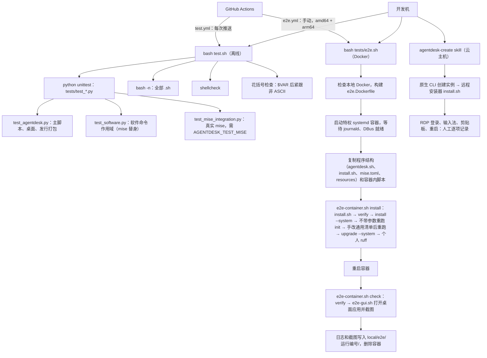

# AgentDesk 测试指南

> 契约：只写现状，必须与代码一致。

## 概述

AgentDesk 的测试分三层：离线测试（`test.sh`）、Docker E2E（`tests/e2e.sh`）和云主机真机验收（`agentdesk-create` skill）。三层逐层更慢、更接近真实环境，各自只覆盖下一层做不到或做得太慢的部分。前两层也在 GitHub Actions 上运行：`.github/workflows/test.yml` 在每次推送和 PR 时运行离线测试；`e2e.yml` 手动触发，在 `ubuntu-26.04`（amd64）和 `ubuntu-26.04-arm`（arm64）runner 上各跑一遍 E2E，日志和截图作为 artifact 上传。本文说明每一层的范围、流程、编写约定和后续规划，新增测试时以本文为准。

| 层 | 入口 | 耗时 | 依赖 | 证明什么 |
|---|---|---|---|---|
| 离线 | `bash test.sh` | 约 10 秒 | Python 3；可选 ShellCheck、mise | 脚本逻辑、参数、作用域隔离和安全保护正确 |
| E2E | `bash tests/e2e.sh` | 30 分钟以上，首次下载约 1.3 GB | 本地 systemd Docker（默认本机架构） | 发行包能在干净的系统（默认 Ubuntu 26.04）上真实安装、重跑、更新、重启，且桌面应用能打开窗口 |
| 真机 | `agentdesk-create` skill | 小时级 | 云账号与原生 CLI | 真实 RDP 登录、中文输入、剪贴板、断线重连和重启后的实际体验 |

## 流程



## 离线测试：`test.sh`

`test.sh` 放在仓库根目录，与被测的 `agentdesk.sh` 并列。这是 gox shell 规范的要求（"Ship a `test.sh` next to any non-trivial script"），它也是离线测试的唯一入口。`tests/` 目录只放测试用例和 E2E 脚本，不另设入口。

按顺序执行四项，任何一项失败都返回非 0：

1. `python3 -m unittest discover -s tests`：运行全部 `tests/test_*.py`。
2. `bash -n`：检查全部 `.sh` 的语法（不含 `local/`）。
3. `shellcheck`：未安装时只打印警告并跳过。
4. 花括号检查：`$VAR` 后面紧跟非 ASCII 字符时报错，避免 bash 把中文字节当成变量名的一部分。

| 文件 | 覆盖内容 |
|---|---|
| `tests/test_agentdesk.py` | 参数校验（不带参数显示帮助、只有选项没有命令报错）、系统矩阵（含 arm64、未验证系统警告、旧版本拒绝）、锁文件平台跟随本机架构、dry-run 不产生写入、xrdp 渲染与读取、密码不被重置、默认桌面账户、mise 来自官方 apt 源、代理白名单、程序文件结构、install.sh 本地与管道两种方式；桌面系统默认值（主题/语言/会话文件为 POSIX sh/模板占位符全部替换/面板启动器）、登录环境（普通用户加路径、root 不变、重复加载不重复）、主题下载失败传递、desktop-reset（不加 --force 拒绝、删除个人覆盖且不留备份、拒绝活动会话、拒绝符号链接）；设置文件（写入/读取/优先级/注释与引号/非法值）；自我更新（最新标签解析、新版本重跑 init、已是最新、显式 ref、缺设置文件拒绝、dry-run、非法参数）；install.sh 默认最新标签与无发布时的提示；`--proxy`（导出变量、拒绝 SOCKS/路径/裸主机、init 与 update 接受、install.sh 管道方式使用代理且不把它传给 init、非法代理在下载前拒绝）；`--remote` 在源码目录内也下载；`agentdesk update` 交给已安装的 install.sh 下载|
| `tests/test_software.py` | install/update/run 的个人与 `--system` 作用域、`MISE_IGNORED_CONFIG_PATHS`（个人操作只在锁定和 apt 包命令上忽略系统清单）、锁定安装失败时的提示、错误参数在调用 mise 前被拒绝、失败退出码透传、软链入口；`upgrade` 命令；`--system` 带名称写入 `config.local.toml` 而不是通用清单；系统操作不设置 `MISE_SYSTEM_CONFIG_FILE`；`--proxy` 写在子命令前后都传到 mise，`run` 任务名之后的 `--proxy` 留给任务 |
| `tests/test_mise_integration.py` | 用真实 mise 验证个人配置写入、XDG 路径、任务的 stdout 与工作目录、两个方向的配置隔离；不下载、不安装软件；系统目录 `config.local.toml` 在 `config.toml` 之后加载并覆盖其版本 |

运行真实 mise 集成测试：

```bash
AGENTDESK_TEST_MISE="$(command -v mise)" bash test.sh
```

### 编写约定

- **不碰主机**：使用 `tempfile` 临时 HOME，外部命令（`mise`、`curl`、`git`、`pgrep`、`xfconf-query`、`xrandr`）用写入临时 `bin/` 的替身代替，不调用真实的 sudo、apt 或云 CLI，不联网。
- **测函数，不测整机**：通过 `source agentdesk.sh` 后直接调用函数（见 `HostTests.function`）。需要 root 或 Linux 的路径用 dry-run 或替身覆盖，真实效果留给 E2E。
- **同时测保护分支**：每个新行为至少覆盖正常路径和一个拒绝路径（参数错误、拒绝覆盖、前置条件不满足），并断言退出码（0、1、2 的含义见 `--help`）。
- **断言写入了什么，也断言没写什么**：例如 dry-run 后临时目录为空、个人操作不出现系统清单。
- **依赖缺失要显示跳过**：用 `unittest.skipUnless` 并写明原因，不能静默通过。

## Docker E2E：`tests/e2e.sh`

| 文件 | 运行位置 | 作用 |
|---|---|---|
| `tests/e2e.sh` | 开发机 | 拒绝远程 Docker，构建镜像，创建并启动容器，用 tar 流复制程序结构（不带 local/），分两阶段执行，最后导出日志 |
| `tests/e2e.Dockerfile` | 构建 | 基础镜像由 `--image` 指定（默认 Ubuntu 26.04）+ systemd + Xvfb、xdotool、scrot 等测试工具；产品软件由真实 `install.sh` 安装 |
| `tests/e2e-container.sh` | 容器内（root） | `install` 阶段：首次安装 → verify → 确认参数已保存 → `install --system apt:htop` 写入 local 文件 → 不带参数重跑 init，校验清单、锁、密码不变且仍为 tunnel → 手改通用清单后重跑 init，校验被直接覆盖、local 文件保留 → `upgrade --system` → 个人安装 ruff、原生 `mise use -g` → `upgrade`；`check` 阶段：重启后再次 verify |
| `tests/e2e-gui.sh` | 容器内（桌面用户） | 在 Xvfb 中启动 XFCE，检查回收站后端，依次打开 Chrome、VS Code 并截图 |

```bash
bash tests/e2e.sh --dry-run                                  # 只打印计划
bash tests/e2e.sh                                            # 完整运行：Ubuntu 26.04、本机架构
bash tests/e2e.sh --image debian:13                          # 其他系统
bash tests/e2e.sh --arch amd64                               # 指定架构（需要该架构能跑 systemd）
bash tests/e2e.sh --proxy http://host.docker.internal:7890   # 受限网络
bash tests/e2e.sh --keep                                     # 保留容器排错
```

- **前置条件**：本地 Docker 能运行特权 systemd 容器；默认使用 Docker 本机架构，`--arch` 可指定。容器不挂载宿主目录或 Docker socket，不开放端口，不读取云或 AI 账号凭据。结果写入 `local/e2e/<运行编号>/`。
- **代理**：`--proxy` 或 `AGENTDESK_E2E_PROXY` 只作为镜像构建参数和容器环境变量传入，回环地址直连。产品脚本自己负责把代理透传给 sudo、桌面用户和 mise。GUI 冒烟测试会给 Chromium/Electron 显式传入 `--proxy-server`。拉取基础镜像走 Docker 引擎自己的网络配置。
- **已知环境限制**：在 Apple Silicon + OrbStack 上，Ubuntu 26.04 amd64 的 journald/logind 会以 `SIGTRAP` 退出。入口检测到 journald 或 DBus 不可用时，会在下载产品前以退出码 2 结束。在 Apple Silicon 上使用默认的 arm64 即可，amd64 改到原生 amd64 Linux 上运行。
- **不覆盖**：install.sh 的远程下载方式（E2E 使用本地方式，远程方式由离线测试中的假 curl 覆盖）、WhiteSur 主题下载（测试使用 `--theme none`）、真实 RDP 登录、输入法与剪贴板交互、账号登录和 Cowork/KVM。上游没有新版本时，update 只能证明流程跑通，不能证明跨版本升级。

## 真机验收：`agentdesk-create` skill

流程见 [skills/agentdesk-create/SKILL.md](../skills/agentdesk-create/SKILL.md)：原生 CLI 创建实例，用远程安装器（未发布的改动则上传程序结构）执行 `install.sh` 和 `agentdesk verify`，再人工检查 RDP 体验。结果逐项记为通过、失败或待验证，写入 [ROADMAP.md](ROADMAP.md) 中的待验收项。服务 active 或包安装成功都不能代替 GUI 验收。

## 新增测试放哪一层

| 改动 | 放哪一层 |
|---|---|
| 参数、校验、生成的文件内容、作用域、退出码 | 离线单元测试，必加 |
| 依赖真实 mise 行为（配置合并、隔离、锁） | `test_mise_integration.py` |
| apt 包、systemd 服务、安装顺序、重启后的状态 | E2E 的 `e2e-container.sh` |
| 应用能否启动出窗口 | E2E 的 `e2e-gui.sh` |
| RDP 体验、输入法、剪贴板、云网络 | 真机验收清单 |

## 后续规划

1. 其他系统用 e2e 工作流的 `image` 输入或本地 `--image` 按需运行，不预先建矩阵。
